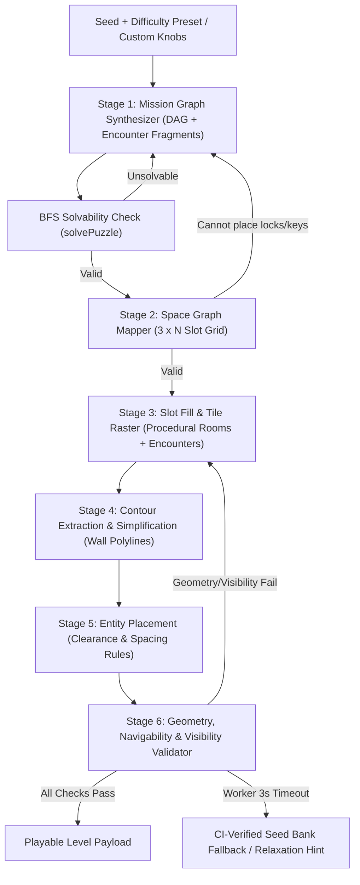

# Game Design & Technical Specification: Procedural Underground ("The Abyssal Descent")

**Document Version:** 2.0 (Revised Architecture Spec)  
**Target Audience:** Game Design Team, Engineering Lead  
**Scope:** Implementation-ready specification for the procedural subterranean level (`deep_cave`) in *Give & Take*

---

## 1. Executive Summary & Vision

In *Give & Take*, subterranean levels introduce a distinct gameplay tension: **limited visibility, tight corridor navigation, spatial inventory management, and blocked-passage puzzles**.

The original `underground` level remains intact as a handcrafted introductory experience (Level 1). This specification defines **"The Abyssal Descent"** (`id: 'deep_cave'`), a new standalone level registered in `src/levels/index.js` (`LEVEL_REGISTRY`) that shares Underground item and entity art while introducing a **puzzle-first, slot-grid procedural engine** capable of blending generated caverns with curated special encounter rooms.

### High-Level Pipeline (Puzzle-First Architecture)



---

## 2. Core Architectural Decisions

| Area | Decision |
| :--- | :--- |
| **Level Integration** | Standalone level `deep_cave` ("The Abyssal Descent") in `LEVEL_REGISTRY`; Level 1 (`underground`) remains untouched. |
| **World Shape & Camera** | Vertical-only scrolling, 1 canonical screen wide; total height scales with difficulty (`rows`). |
| **Coordinate System** | **Isotropic canonical units** (`100` width units; `9:19.5` canonical viewport = `216.67` units tall), rendered uniformly with dark letterbox bars on other aspect ratios. |
| **Geometry Engine** | Spelunky-style **room-slot grid** (`3` columns × `N` rows) backed by a tile raster, extracted into wall polylines via marching squares + simplification, with standardized N/S/E/W doorway collars. |
| **Curated Encounters** | JS encounter modules with validated 2D tile grids, doorway sockets, puzzle fragments (`inputs`/`outputs`), placement rules, and optional mechanic/solver hooks. v1 ships the framework + 2–3 sample encounters. |
| **Generation Order** | **Puzzle-first**: Mission Graph → Space Graph → Slot Fill → Contouring → Entity Placement → Validation, with independent per-stage retries. |
| **Soft-Lock Policy** | Dead states are allowed freely (Undo and Restart are always available). The solver guarantees at least one valid solution exists from the start. |
| **Cave Memory** | **No memory** — areas outside the ray-cast torch polygon remain fully dark (matching Level 1 tension). |
| **Torch Radius** | Controlled by Difficulty Preset / Advanced knob (with a playtested minimum floor) and enforced by the visibility validator. Menu lighting slider is dev/debug only for `deep_cave`. |
| **Persistence** | **Dual format**: compact autosave (`seed`, `settings`, `generatorVersion`, runtime state) that regenerates deterministically on load, plus full self-contained debug snapshot export. |
| **Execution** | Runs asynchronously in a **Web Worker** with `"Carving the cave..."` loading UI; p95 target `< 500 ms`, `3000 ms` hard timeout with CI seed-bank fallback. |

---

## 3. Coordinate System & Viewport Model

### 3.1 Why Level 1 Coordinates Cannot Be Reused Directly
In Level 1 (`underground`), `x` spans `0..100` (viewport width) while `y` spans `0..100` across `screens: 2.5` vertical screens inside a `9:19.5` container (`preserveAspectRatio="none"`). Consequently, 1 vertical unit is roughly 5.4× longer on screen than 1 horizontal unit, distorting Euclidean distance checks (`Math.hypot`) and diagonal corridor widths.

### 3.2 Canonical Isotropic World Space (`deep_cave`)
`deep_cave` introduces isotropic world units (`mechanics.useIsotropicCoords: true`):
- **Horizontal Unit**: `W_world = 100.0` units across the canonical play window.
- **Vertical Unit**: `1.0` Y unit equals `1.0` X unit on screen (no stretching).
- **Canonical Screen Height**: At the canonical `9:19.5` portrait aspect ratio, one visible screen height is:
  \[
  H_{\text{screen}} = 100 \times \frac{19.5}{9} \approx 216.67 \text{ world units}
  \]
- **Total Level Height**: For a grid of \(R\) rows with slot height \(H_{\text{slot}}\), total world height is \(H_{\text{world}} = R \cdot H_{\text{slot}}\).
- **Uniform Scaling & Letterboxing**: The playfield scales uniformly (`preserveAspectRatio="xMidYMid meet"` / CSS aspect container) to fit the device viewport within the `9:19.5` canonical aspect frame. Excess screen area outside the canonical frame renders as plain dark letterbox bars so taller phones never see further vertically and circular torch polygons / boulders remain geometrically true.

### 3.3 Constants in Isotropic Units
All spatial constants for `deep_cave` are defined in isotropic world units (replacing Level 1's mixed `%` constants):

| Constant | Value (Isotropic Units) | Rationale / Correspondence |
| :--- | :--- | :--- |
| **Hero Pathfinding Clearance Radius** | `r_hero = 3.0` | Replaces Level 1's anisotropic `radius = 2.0` (`src/logic/pathfinding.js`) and `3.5` stop-offset (`GameInstance.jsx`). |
| **Minimum Corridor Clear Width** | `W_min = 20.0` | Guarantees \(\ge 3.3 \times\) hero diameter (`6.0`) along any axis (horizontal, vertical, or diagonal). |
| **Minimum Entity Separation** | `D_min = 14.0` | Prevents overlapping entity sprites and `±8` reward/bubble offsets in both X and Y. |
| **Minimum Wall Margin** | `M_min = 6.5` | Keeps interactables clear of wall strokes and hero approach points. |
| **Default Torch Radius Range** | `R_torch ∈ [48, 72]` | Isotropic circle radius (~48%–72% of play width); minimum floor tuned by playtesting so darkness stays tense but playable. |

---

## 4. Room-Slot Grid, Tile Raster & Contouring Engine

### 4.1 The `3 × N` Room-Slot Grid
The world is partitioned into a coarse grid of `C = 3` columns by `R` rows (`R` scales from `3` on Easy up to `6+` on Expert):
- **Slot Dimensions**:
  - Slot width: `W_slot = 33.33` units (`3 × 33.33 = 100.0` total width; outer world border margins carved from columns 0 and 2).
  - Slot height: `H_slot = 64.0` units (about 3.4 slots fit vertically per screen, keeping multi-room tactical context readable while maintaining verticality).
- **Row 0**: Contains the **Camp Chamber** (surface light spill, starting resources, initial hint/trade options).
- **Row `R - 1`**: Contains the **Ancient Vault** (goal entity and celebratory treasure).
- **Slot Connectivity**: Adjacent slots connect along cardinal edges (`N`, `S`, `E`, `W`) via standardized **Doorway Sockets**. A slot can be empty solid rock (unvisited), a single chamber, a multi-slot curated encounter (e.g., `2×1` or `2×2`), or a dead-end spur.

### 4.2 Tile Raster & Standardized Doorway Collars
Each slot maps to a fine tile grid (e.g., `10 × 18` tiles per slot, where `1 tile ≈ 3.33 × 3.55` world units — roughly `1 tile ≈ r_hero`):
- **Doorway Sockets**: Every open connection between two adjacent slots carves a centered, orthogonal passage of fixed width (at least `6` tiles / `20+` units wide) surrounded by a **3-tile straight collar**.
- **Guaranteed Flush Gatekeepers**: Because every doorway socket is strictly axis-aligned (horizontal seam for N/S passages, vertical seam for E/W passages) and bounded by straight collar walls, any **Rock**, **Chasm**, or **Guardian** gatekeeper placed across a doorway is guaranteed **100% flush wall-to-wall with zero gaps**, regardless of how organic the interior room walls are.
- **No `dx/dy = 0` Limitation**: Unlike Level 1's `getCorridorBounds` (which assumed walls were monotonic functions \(x(y)\) and only supported 1 central pillar), the slot-tile raster naturally supports arbitrary pillars, E/W cross-tunnels, side spurs, and multi-channel forks.

### 4.3 Contour Extraction & Organic Geometry
Once all slots and doorway collars are rasterized into a unified boolean solid/open tile map (plus cellular/noise smoothing *away* from doorway collars):
1. **Marching Squares**: Extract closed obstacle boundary loops (`wallPolylines` and solid `polygons`).
2. **Collar-Preserving Simplification**: Apply Ramer–Douglas–Peucker polyline simplification while **locking collar corner vertices** so doorway seams stay exact.
3. **Output**: Produces per-puzzle `wallPolylines` and `obstaclePolygons`, consumed directly by `getVisibilityPolygon`, `findGlobalPath`, and the SVG renderer (replacing the static `CAVE_WALL_VERTICES` and hardcoded SVG paths used in Level 1).

---

## 5. Curated Encounter Framework

Curated encounters allow designers to inject hand-authored puzzles, spatial set-pieces, and special mechanics into any procedural run without breaking solvability or geometry guarantees.

### 5.1 Encounter Module Contract (`src/levels/deep_cave/encounters/<id>.js`)
To ensure stability and prevent fragile string-parsing bugs, every encounter module is validated by a schema/lint test in CI at build/test time:

```js
export default {
  id: 'rope_chasm_bridge',
  footprint: { cols: 2, rows: 1 }, // 1x1, 2x1, 3x1, or 2x2 slots
  sockets: {
    // Allowed/required open connections relative to footprint origin
    north: [{ colOffset: 0, required: true }],
    south: [{ colOffset: 1, required: true }],
    east: [],
    west: [],
  },
  // Validated 2D tile grid matching footprint dimensions (10*cols x 18*rows):
  // '#' = wall, '.' = floor, 'C' = doorway collar, 'G' = gatekeeper anchor,
  // 'E' = entity anchor, 'L' = chasm/special anchor
  tileGrid: [ /* ... */ ],
  puzzleFragment: {
    // Mission-graph splice interface
    inputs: ['rope'],              // Items consumed from outside to traverse/solve
    outputs: ['crystal'],          // Items produced inside (optional)
    gatekeepers: [
      { anchor: 'G1', type: 'chasm_bridge', requires: ['rope'], unlocksExit: 'south:1' }
    ],
    internalSteps: 1,              // Contribution to targetSteps
  },
  placement: {
    minDifficulty: 'easy',
    depthRange: [0.25, 0.85],      // Normalized row fraction (excludes Camp & Vault)
    maxPerLevel: 1,
    weight: 1.0,
  },
  // Optional: custom runtime interaction + matching BFS solver transition
  mechanicHook: null,
};
```

### 5.2 Validation Rules for Encounters
1. **Socket Alignment**: Every declared socket in `sockets` must align cleanly with `'C'` collar tiles on the perimeter of `tileGrid`.
2. **Self-Contained Solvability**: Given its declared `inputs`, every internal reward and exit declared in `puzzleFragment` must be reachable and completable.
3. **Solver Parity**: Any encounter defining a `mechanicHook` MUST provide a corresponding deterministic transition function for `solvePuzzle`; encounters without a solver hook are rejected by the validator.

### 5.3 v1 Sample Encounters (3 Encounters)
1. **Rope Chasm Bridge (`rope_chasm_bridge`, `2×1`)**: A wide subterranean fissure splitting an upper ledge from a lower exit; requires consuming 1 `rope` at the chasm anchor to string a permanent crossing.
2. **Guardian Lair (`guardian_lair`, `1×1`)**: A narrowed ambush chamber guarded by a blocking creature (e.g., Giant Spider or Scorpion) across the south collar that must be bartered past rather than mined.
3. **Mushroom Grotto (`mushroom_grotto`, `2×1`)**: A branching fungal pocket behind a rock collar housing a preset mushroom resource + an exchange trader, rewarding a side detour with key progression items or spare tools.

---

## 6. Puzzle-First Generation Pipeline

Reversing the v1.0 draft's geometry-first order eliminates expensive full-level retries when a barter chain fails to match `targetSteps`.

### Stage 1: Mission Graph Synthesizer
1. **Select Difficulty Vector** (from preset or Advanced knobs: `targetSteps`, `rows`, `branchingFactor`, `spurCount`, `decoyCount`, `pickaxeSurplus`, `maxBacktrackRows`, `maxBacktracks`, `numDiggers`, `encounterCount`, `torchRadius`).
2. **Splice Encounters**: Pick `0..encounterCount` eligible encounters matching depth/difficulty rules and reserve their `inputs`, `outputs`, and `internalSteps`.
3. **Synthesize Barter & Gate DAG**:
   - Generate `2–3` starting items at Camp.
   - Build a chain of item-to-item exchange traders, tool pickups (`pickaxe`, `rope`), blocking **Rock** doorways (consume `1` `pickaxe`; pickaxes stack in 1 inventory slot so no separate charge system is needed), **Chasm** doorways (consume `1` `rope`), and **Guardian** doorways (barter trade) reaching the Vault goal.
   - Enforce **No Self-Guarded Items**: no trader or gatekeeper may ever require the item it grants or unlocks.
   - Add `decoyCount` non-essential / trap trades and `pickaxeSurplus` extra tools according to difficulty.
4. **Immediate Solver Check**: Run `solvePuzzle` on the abstract mission graph (with `MAX_UNIQUE_ITEMS = 4` inventory limit). Verify a solution exists with step count within `[targetSteps, targetSteps + 1]`. Retry Stage 1 cheaply (`< 5 ms`) if invalid.

### Stage 2: Space Graph Mapper (`3 × N` Slot Grid)
1. **Carve Main Spine & Branches**: Place Camp at row `0`, Vault at row `R - 1`, and route main progression + `branchingFactor` parallel channels + `spurCount` dead-end caches across the `3 × N` grid.
2. **Place Encounters**: Anchor selected encounter footprints into compatible grid slots and bind their sockets into the adjacency graph.
3. **Assign Zones & Locks**:
   - Partition the slot graph into zones separated by gatekeeper doorways (`rock`, `chasm`, `guardian`).
   - Place keys/rewards in zones reachable *before* their corresponding gatekeeper, respecting the backtracking budget: at most `maxBacktracks` dependencies whose source slot lies deeper than its target slot, and by at most `maxBacktrackRows` rows.

### Stage 3: Slot Fill & Tile Rasterization
- Fill encounter slots with their validated `tileGrid`.
- Fill procedural slots from a catalog of room archetypes (e.g., wide hall, central-pillar split, angled chamber, narrow alcove) parameterized by active doorway sockets (`N/S/E/W`), applying seeded organic wall noise strictly outside the 3-tile doorway collars.

### Stage 4: Contour Extraction
- Run Marching Squares + collar-preserving simplification on the composite tile grid to generate `wallPolylines` and `obstaclePolygons`.

### Stage 5: Entity Placement
- Place traders, presets (`pickaxe`, `rope`, `mushroom`), Giant Mole roamers (`numDiggers`), and Vault treasure inside their assigned slots using seeded rejection sampling against:
  - **Pairwise Separation**: \(\text{dist}(E_a, E_b) \ge D_{\min} = 14.0\) within the same zone/slot.
  - **Wall Clearance**: \(\min_{s} \text{dist}(E, s) \ge M_{\min} = 6.5\) from all `wallPolylines`.
  - **Doorway Clearance**: Entities may not sit inside doorway collar footprints (except the gatekeeper anchored to that doorway).

### Stage 6: Headless Verification Suite
Every generated level must pass all 5 checks before leaving the worker:
1. **Topological Solvability (`solvePuzzle`)**: Full puzzle entity graph is solvable from `startItems` within the `4`-slot inventory limit.
2. **Corridor Navigability (`findGlobalPath`)**: A* pathfinding at `r_hero = 3.0` confirms continuous walkable paths from Camp to every non-gatekeeper entity and through every gatekeeper doorway (when unlocked).
3. **Doorway Collar Sealing**: Every gatekeeper sits inside a strictly orthogonal collar segment pair with `0` horizontal/vertical gap between its bounding box and the flanking walls.
4. **Spatial Clearance (`validateEntitySpacing`)**: Pairwise entity distances \(\ge 14.0\) and wall margins \(\ge 6.5\) in isotropic coordinates.
5. **Torch Visibility Reachability**: Using `getVisibilityPolygon` at the level's configured `torchRadius`, every gatekeeper and interactable entity is visible from at least one reachable hero standing position in its zone.

---

## 7. Gameplay Mechanics, Difficulty Presets & Knobs

### 7.1 Mechanics in v1
- **Rock Doorways**: Block passage (`isGatekeeper: true`); cleared by consuming `1` `pickaxe`. Because pickaxes stack in a single inventory slot, multi-rock paths naturally require accumulating multiple pickaxes without adding a separate durability/charge state.
- **Chasm Doorways**: Block passage across fissures; cleared by consuming `1` `rope`, leaving a permanent rope bridge.
- **Guardian Doorways**: Blocking creatures placed in a doorway collar; cleared by completing their barter requirement.
- **Barter Traders & Giant Mole**: Standard non-blocking traders and burying/roaming Mole entities (`numDiggers`) from Level 1.
- **Dead States**: Players can freely spend limited tools or trade items into unrecoverable states; **Undo** and **Restart** remain the primary recovery tools.

### 7.2 Difficulty Presets & Advanced Overrides
The UI presents a primary **Difficulty Preset** (`Easy`, `Normal`, `Hard`, `Expert`) plus an expandable **Advanced Settings** drawer exposing every knob (editing any knob switches the active preset label to `Custom`):

| Knob | Easy | Normal | Hard | Expert |
| :--- | :--- | :--- | :--- | :--- |
| `targetSteps` | `5` | `8` | `12` | `16` |
| `rows` (grid height) | `3` | `4` | `5` | `6` |
| `branchingFactor` | `1` (mostly single spine + 1 split) | `2` | `2–3` | `3` |
| `spurCount` (dead-end caches) | `1` | `2` | `3` | `4` |
| `decoyCount` | `0` | `1` | `2` | `3` |
| `pickaxeSurplus` | `+2` | `+1` | `0` | `0` |
| `maxBacktracks` / `maxBacktrackRows` | `0 / 0` | `1 / 1` | `2 / 2` | `3 / 4` |
| `numDiggers` | `0` | `1` | `1` | `2` |
| `encounterCount` | `1` | `1–2` | `2` | `2–3` |
| `torchRadius` (isotropic units) | `68` | `58` | `52` | `48` |

---

## 8. Persistence, Export & Worker Execution

### 8.1 Web Worker & Latency Budget
- Generation runs inside a dedicated Web Worker (`deepCaveWorker.js`) so the React main thread remains responsive and displays a `"Carving the cave..."` indicator.
- **Performance Target**: `p95 < 500 ms` on mid-range mobile hardware.
- **Hard Cap & Fallback**: If generation exceeds `3000 ms`:
  - For standard presets (`Easy` / `Normal` / `Hard` / `Expert`): deterministically load a level from a **CI-verified seed bank** bundled for that preset and `generatorVersion`.
  - For `Custom` Advanced configurations: surface a clear prompt suggesting which tight constraints to relax (e.g., increasing `rows` or lowering `targetSteps`/`encounterCount`).

### 8.2 Dual Persistence (`src/logic/saveState.js`)
1. **Compact Autosave (Local Storage)**:
   - Stores `{ version, generatorVersion, levelId: 'deep_cave', seed, settings, inventory, unlockedZones, defeated, pathHistory, historyStack, campItems, buriedEntities }`.
   - On resume, if `generatorVersion` matches the current build, the worker/loader deterministically regenerates geometry and entities from `(seed, settings)`. If `generatorVersion` differs, the player is warned that the generator has been updated (or restored from snapshot if present).
2. **Debug / Bug-Report Export**:
   - Exports a full, self-contained JSON snapshot including `wallPolylines`, `obstaclePolygons`, `slotLayout`, `puzzleEntities`, `solution`, `seed`, `settings`, `generatorVersion`, and current runtime state so any reported bug can be visually inspected and replayed without relying on version parity.

---

## 9. Engine Refactoring Prerequisites & Phased Roadmap

Implementing `deep_cave` requires decoupling Level 1's static cave assumptions across the shared engine:

| File / Area | Required Change |
| :--- | :--- |
| `src/logic/visibility.js`, `src/logic/pathfinding.js` | Support puzzle-owned `wallPolylines` and `obstaclePolygons` plus `useIsotropicCoords` (skipping `y * screens` distortion for `deep_cave` while preserving Level 1 behavior). |
| `src/components/WorldViewport.jsx`, `GameInstance.jsx` | Add canonical `9:19.5` uniform viewport scaling + dark letterboxing mode when `level.mechanics.useIsotropicCoords` is true; remove `3.5` anisotropic stop-offset assumption. |
| `src/levels/underground/components.jsx` | Allow `RockSVG` (and a new `DeepCaveBackground`) to accept dynamic wall bounds / per-puzzle `wallPolylines` instead of importing module-level `CAVE_WALL_VERTICES`. |
| `src/logic/rules.js` | Add `rope` / chasm doorway support (similar to `pickaxe` gatekeeper handling) and isotropic options in `validateEntitySpacing`. |
| `src/logic/saveState.js` | Add `generatorVersion`, `seed`, and `settings` fields, seed-based hydration hook on load for `deep_cave`, and full-snapshot debug export mode. |
| `src/components/GameMenu.jsx` | Add Difficulty Preset selector + collapsible Advanced Knobs panel; restrict Torch Radius slider to dev/debug mode for `deep_cave`. |

### Phased Delivery Plan
1. **Phase 1 — Engine Decoupling & Isotropic Viewport**: Refactor `visibility.js`, `pathfinding.js`, `WorldViewport.jsx`, `RockSVG`, and `saveState.js` behind `useIsotropicCoords` / puzzle-owned geometry without regressing existing `underground`, `underwater`, or `river_crossing` tests.
2. **Phase 2 — Slot-Grid & Contour Engine**: Implement `3 × N` slot mapping, tile rasterization, doorway collars, Marching Squares + simplification, and a headless visual/unit test harness.
3. **Phase 3 — Puzzle-First Synthesizer & Encounters**: Build the Mission Graph synthesizer, Space Graph mapper, encounter validator, and the 3 v1 encounters (*Rope Chasm Bridge*, *Guardian Lair*, *Mushroom Grotto*).
4. **Phase 4 — Worker, UI & CI Fuzzing**: Wire the Web Worker, `"Carving the cave..."` loading state, Difficulty Preset + Advanced knobs UI, CI seed bank generation, and run 1,000-seed fuzz benchmarks.

### Measurable Verification & CI Targets
Instead of measuring only pass rate (which a retry loop makes trivially 100%), CI fuzzing across `1,000` randomized seeds per preset must report and pass:
- **First-Pass Mission Graph Solve Rate**: `>= 85%`
- **Median / p95 Total Generation Time**: `< 150 ms` / `< 500 ms`
- **Timeout Fallback Rate (`> 3000 ms`)**: `< 0.5%` on all standard presets
- **Step Accuracy**: `100%` within `[targetSteps, targetSteps + 1]`
- **Geometric & Visibility Validation**: `100%` pass on `findGlobalPath`, collar zero-gap orthogonality, `validateEntitySpacing`, and `torchRadius` visibility reachability.

---

## 10. Explicitly Deferred to v2+

The following ideas are intentionally out of scope for v1 to keep the core engine sharp and testable:
- **Dead-end hint systems** (peek windows, wall pictograms, bat/mushroom behavioral clues).
- **Additional environmental hazards** (crumbling stalactites, flooded sumps, subterranean air/stamina depletion).
- **Additional tool types** (reusable whip, slot-occupying permanent tools, one-way drop ledges, dynamite retheme of pickaxe).
- **Explored-area cave memory / minimap**.
